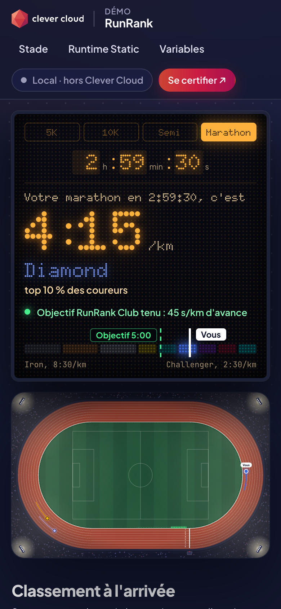

# RunRank, a floodlit athletics stadium — Static runtime on Clever Cloud

> A night at the track. Pick a race and type your time on the stadium's LED scoreboard: your pace lights up in amber dots, your rank (Iron to Challenger) in its own colour, and around it you circle a 400 m track seen from above, next to an elite hare (the 2-hour marathon), a Sunday marathoner and the club's green pacing lights running at `GOAL_PACE`. Your share link becomes a race bib. React 18, Vite 8 and TypeScript, built on your machine and committed in `dist/`: the **Clever Cloud Static runtime** serves it as-is, with no remote build and no application process. The page proves it: a photo-finish of the files it just received, the security headers it reads on itself, and the `config.json` a pre-run hook wrote before the start.




**Run it yourself.** The hosted demo was taken down after the presales review (November 2026). The steps in [Deploy on Clever Cloud](#deploy-on-clever-cloud) recreate it from scratch in about 2 minutes.

**Get certified.** This demo runs on Clever Cloud. To deploy your own apps the same way, get certified at the [Clever Cloud Academy](https://academy.clever.cloud/).

## What the Static runtime does here

| Where | Clever feature | What you see |
|---|---|---|
| `dist/` | Static runtime, `CC_WEBROOT=/dist` | The committed Vite build, served as-is. The *photo-finish* panel lists every file the browser received from the app (`index.html`, one JS, one CSS, `config.json`) with its size and arrival time, read from the Resource Timing API: the whole app is about 75 kB on the wire. Without `CC_WEBROOT`, the repo root and its source `index.html` are served: a blank page |
| Every start, deploy and `clever restart` | `CC_PRE_RUN_HOOK=./scripts/write-config.sh` ("This hook runs every time", hooks documentation) writes the app's variables to `dist/config.json` | The *start list* panel shows the `config.json` served; the LED ribbon, the club on the bib, the speed of the green pacing lights and the goal flag on the scoreboard follow the console; the bib footer says « config.json écrit par CC_PRE_RUN_HOOK à hh:mm:ss » |
| Web server | The `Caddyfile` at the repo root, detected by the Static runtime and run (`caddy run`) instead of the default server (SWS), which cannot set HTTP headers. Its root is `{$APP_HOME}/{$APP_FOLDER}/dist`, so the same file works for this repo alone and from a catalogue deployed with `APP_FOLDER` | The *ratification* sheet: the page sends `HEAD` requests to itself and to its JS bundle and ticks CSP, HSTS, `X-Content-Type-Options`, `X-Frame-Options`, `Referrer-Policy` and the missing `Server` header, then stamps « Homologué ». It also shows `no-cache` on the page and `immutable` on the hashed `dist/assets/` files |
| Restart from the build cache | `CC_OVERRIDE_BUILDCACHE=dist:scripts:Caddyfile` | The hook script and the `Caddyfile` are still there after a `clever restart` (checked in production on 2026-10-25, deploy and restart) |
| Deploy | `CC_HEALTH_CHECK_PATH=/config.json`, `CC_GIT_FULL_CLONE=false` | The deployment is validated once `config.json` is served; the repo is cloned with `--depth 1`, so the history of `dist/` does not slow it down |
| Platform variables | Injected by Clever Cloud, copied into `config.json` by the hook | The *Running on Clever Cloud* panel (`CC_APP_NAME`, `APP_ID`, `INSTANCE_NUMBER`, `INSTANCE_TYPE`, `CC_PRETTY_INSTANCE_NAME`, `CC_COMMIT_ID`, `CC_DEPLOYMENT_ID`) and the bib number, `INSTANCE_NUMBER + 1` |

The Static runtime does **not** read `clevercloud/static.json`: the served folder is set with the `CC_WEBROOT` environment variable (relative to the repo root, default `/`). See the [Static runtime documentation](https://www.clever.cloud/developers/doc/applications/static/).

## Deploy on Clever Cloud

You need [clever-tools](https://www.clever.cloud/developers/doc/cli/) (`clever login` done) and the ID of the organisation that will own the resources (`orga_…`, shown in the Console). Run the commands from the repo root: `clever create` links the folder to the new app. The build is already committed in `dist/`; after a change, run `npm run build` and commit `dist/` before deploying, or Clever Cloud keeps serving the previous version.

```bash
# 1. The app and its size (Static: nothing is built on Clever Cloud)
clever create --type static demo-react-vite --org <org_id> --region par
clever scale --min-flavor nano --max-flavor XS --min-instances 1 --max-instances 2

# 2. Variables
clever env set CC_WEBROOT /dist                                # folder served
clever env set CC_PRE_RUN_HOOK ./scripts/write-config.sh       # env vars -> dist/config.json, on every start
clever env set CC_OVERRIDE_BUILDCACHE dist:scripts:Caddyfile   # keep the hook script and the Caddyfile for restarts
clever env set CC_HEALTH_CHECK_PATH /config.json
clever env set CC_GIT_FULL_CLONE false                         # shallow clone, faster deploys

# 3. Deploy
clever deploy
clever open
```

No add-on. To show the variables live, then `clever restart` and reload: the LED ribbon scrolls under the top bar, the club name changes on the bib, the green pacing lights speed up and the goal flag moves on the scoreboard (« encore 21 s/km à gagner » for the default 10 km in 48:30), and the bib pill turns to `production`.

```bash
clever env set ANNOUNCEMENT "Démo live"
clever env set CLUB_NAME "Les Foulées Nantaises"
clever env set GOAL_PACE 4:30
clever env set APP_ENV production
clever restart
```

## Variables

| Variable | Set by | Role |
|---|---|---|
| `CC_WEBROOT` | you | `/dist`, the folder served |
| `CC_PRE_RUN_HOOK` | you | `./scripts/write-config.sh`: writes `dist/config.json` before every start |
| `CC_OVERRIDE_BUILDCACHE` | you | `dist:scripts:Caddyfile`: with `CC_WEBROOT` set, the build cache keeps only the served folder and a few configuration files, so the hook and the `Caddyfile` must be listed |
| `CC_HEALTH_CHECK_PATH` | you | `/config.json` |
| `CC_GIT_FULL_CLONE` | you | `false`: clone with `--depth 1` |
| `APP_ENV` | optional, default `local` | Environment pill on the bib (solid navy when `production`) |
| `ANNOUNCEMENT` | optional, empty | Scrolling LED ribbon under the top bar (static with reduced motion) |
| `CLUB_NAME` | optional, default `RunRank Club` | Bib header, goal sentence on the scoreboard, pacing lights in the results |
| `GOAL_PACE` | optional, default `5:00` | Speed of the green pacing lights along the inner kerb, goal flag on the scoreboard's rank scale, goal sentence (held, or s/km to gain), target time on the pace band. `m:ss` between 2:00 and 12:00; anything else falls back to the default and the bib says the value was ignored |

A static app cannot read environment variables in the browser: the hook copies them into `dist/config.json` and the app fetches it with `cache: "no-store"`. Missing or invalid file: safe defaults, the page still renders. The *Running on Clever Cloud* panel shows `CC_APP_NAME`, `APP_ID`, `INSTANCE_NUMBER`, `INSTANCE_TYPE`, `CC_PRETTY_INSTANCE_NAME`, `CC_COMMIT_ID` (short) and `CC_DEPLOYMENT_ID`; `APP_ID` switches the *Live on Clever Cloud* pill. Locally they read « injecté au déploiement » and the panel says *Local*.

The reference hares are plain arithmetic, not records that go stale: the elite hare runs a 2-hour marathon (2:51 /km), the Sunday marathoner 4 h 30 (6:24 /km). The track runs 20 times faster than real life.

## Routes

`/` the stadium; share link `?d=<5|10|21.0975|42.195>&t=<h:mm:ss>` (default 10 km in 48:30), printed on the bib · `/config.json` written by the hook, also the health check · `/assets/*` hashed Vite files, cached for a year. Anything else answers 404 (Caddy). The page itself sends two `HEAD` requests, to `/?homologation` and to its JS bundle, to read the headers it shows.

## Code tour

```
index.html                          Vite source entry (head snippet, Google Fonts incl. Doto, /src/main.tsx)
src/app/App.tsx                     page: top bar, LED ribbon, stadium, results + bib, certification, Static runtime, footer
src/app/config.ts                   reads /config.json (no-store), parsing and defaults
src/app/utils/calculations.ts       pace, rank and percentile logic
src/app/utils/hares.ts              reference hares, track speed-up (x20)
src/app/components/Scoreboard.tsx   LED scoreboard: race, time inputs, pace, rank, goal, rank scale (PaceTrack)
src/app/components/Stadium.tsx      the 400 m track seen from above (SVG), runners and pacing lights (requestAnimationFrame)
src/app/components/RaceResults.tsx  finishing order on your distance, pace band
src/app/components/RaceBib.tsx      the bib: instance number, CLUB_NAME, APP_ENV, share link
src/app/components/PlatformPanel.tsx Running on Clever Cloud
src/app/components/StaticRuntime.tsx photo-finish (Resource Timing), ratification (HEAD on itself), start list (config.json)
src/app/components/clever/          Clever Brand Kit components (logo, badge, top bar, certification medal, footer)
src/styles/cc-brand.css             shared Clever Brand Kit (copied as-is, do not edit)
src/styles/index.css                demo styles (rr-* classes)
public/config.json                  default config, copied to dist/
scripts/write-config.sh             CC_PRE_RUN_HOOK: env vars -> dist/config.json (POSIX sh, no dependency)
Caddyfile                           web server: serves dist/ only, security headers, cache rules
dist/                               committed production build served by Clever Cloud
```

React 18, Vite 8, TypeScript 6, Tailwind CSS 4, lucide-react. `vite.config.ts` sets `build.outDir: 'dist'` with `emptyOutDir: true`.

## Run locally

```bash
npm install
npm run dev                    # http://localhost:5173
npm run build                  # dist/index.html + dist/assets/, then commit dist/
```

Serve the build with the repo's own `Caddyfile` (Caddy 2 installed locally) to see the headers ticked, then test the variables and restore the default `dist/config.json` before committing:

```bash
PORT=8502 caddy run --config Caddyfile --adapter caddyfile     # http://localhost:8502
APP_ENV=production ANNOUNCEMENT="Démo live" CLUB_NAME="Les Foulées Nantaises" GOAL_PACE=4:30 \
  sh scripts/write-config.sh                                   # reload the page
npm run build
```

`npx vite preview` also works, but sets none of the headers: the ratification sheet then says « Non homologué ».

Requires Node.js 20+. The screenshots above come from the committed `dist/` served locally by Caddy (hence « Local · hors Clever Cloud »); the desktop one uses demo variables written by `scripts/write-config.sh`, the phone one the defaults.

## License

[MIT](LICENSE) © 2026 [Vitiosum](https://github.com/Vitiosum)
